<div align="center">

# 🛡️ VeilCred

### Prove what's necessary. Reveal nothing else.

A privacy-preserving digital credential system, built from scratch for an Applied Cryptography course.<br>
Anonymous credentials · selective disclosure · zero-knowledge predicates · unlinkability · private revocation


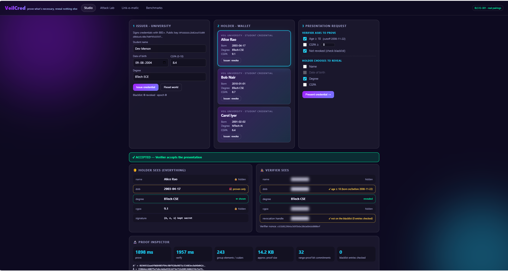

</div>

---

## Contents

- [The idea](#-the-idea)
- [Features](#-features)
- [See it in action](#-see-it-in-action)
- [How it works](#-how-it-works)
- [Quick start](#-quick-start)
- [Try this in 3 minutes](#-try-this-in-3-minutes)
- [Attack Lab](#-attack-lab)
- [Performance](#-performance)
- [Security model and limitations](#-security-model-and-limitations)
- [Project structure](#-project-structure)
- [Built in phases](#-built-in-phases)
- [Roadmap](#-roadmap)
- [References](#-references)

---

## 💡 The idea

Today, proving one fact usually means handing over everything. To show you're over 18, you
show an ID with your name, address and exact birthday. To show a degree, you share a whole
transcript.

**VeilCred flips that.** An issuer (say, a university) signs your credential once. After that,
you decide, for every verifier, what to reveal and what to merely *prove*, in zero knowledge.

> Show the degree, hide the name. Prove "over 18", hide the birthday.
> Verifiers never learn who is presenting, and two presentations can't be linked together.

**What a verifier learns in the demo scenario:**

| Attribute | The holder has | The verifier learns |
|---|---|---|
| Name | Alice Rao | ▓▓▓▓▓▓ *(hidden)* |
| Date of birth | 2003-04-17 | ✔ *born on or before the 18-year cutoff* (value hidden) |
| Degree | BTech CSE | **BTech CSE** *(revealed by choice)* |
| CGPA | 9.1 | ▓▓▓▓▓▓ *(hidden)* |
| Revocation handle | random 128-bit value | ✔ *not on the blacklist* (value hidden) |

---

## ✨ Features

| | Capability | How it works | Code |
|---|---|---|---|
| 🔍 | **Selective disclosure** | Reveal any subset of attributes from a BBS+ signed credential | [`bbs.py`](veilcred/bbs.py) |
| 🧮 | **Zero-knowledge predicates** | Prove *age ≥ 18* or *CGPA ≥ 8* without revealing the values (32-bit range proofs) | [`range_proof.py`](veilcred/range_proof.py) |
| 🕶 | **Unlinkability** | Every presentation re-randomises the signature and uses fresh commitments | [`bbs.py`](veilcred/bbs.py) |
| ♻️ | **Private revocation** | Prove your handle is *not* on the issuer's blacklist, without revealing it | [`revocation.py`](veilcred/revocation.py) |
| 🔁 | **Replay resistance** | Verifier nonce, policy and blacklist digest are bound into the proof | [`transcript.py`](veilcred/transcript.py) |
| ⚔️ | **Attack Lab** | 17 real attack scenarios run against the real code | [`attacks.py`](veilcred/attacks.py) |
| 🎛 | **VeilCred Studio** | A web UI: wallet, split holder/verifier view, proof inspector | [`server.py`](server.py) |

Everything cryptographic above the pairing library is **implemented from scratch**: elliptic-curve
arithmetic, Pedersen commitments, Fiat-Shamir proofs, BBS+, range proofs and the revocation proof.
Only the BLS12-381 pairing itself comes from [`py_ecc`](https://github.com/ethereum/py_ecc).

---

## 🎬 See it in action

### Wallet and presentation request

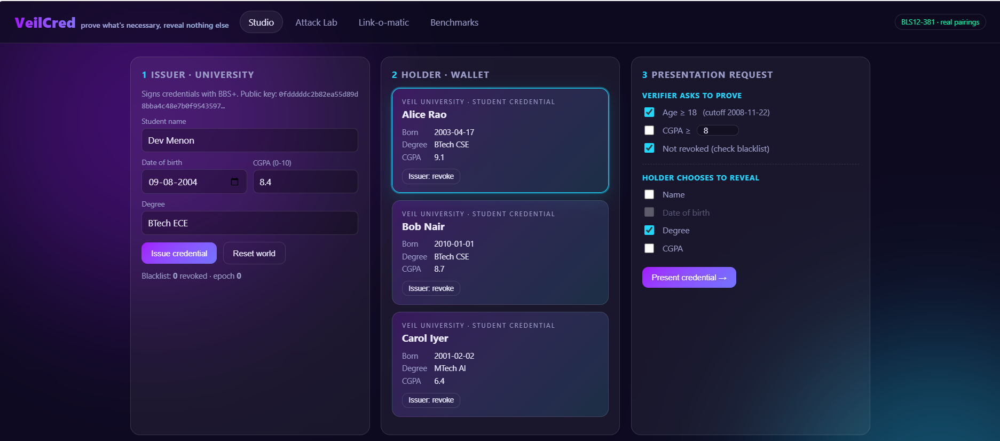

The holder picks a credential and chooses what to reveal. The verifier's policy (age ≥ 18,
CGPA ≥ 8, not revoked) is set on the right.

### Holder sees everything, verifier sees only what's necessary

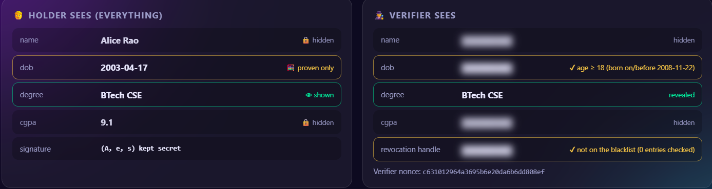

Revealed fields show up in green, predicates appear as "✔ proven" with the value blurred out, and
everything else stays hidden.

### Proof inspector

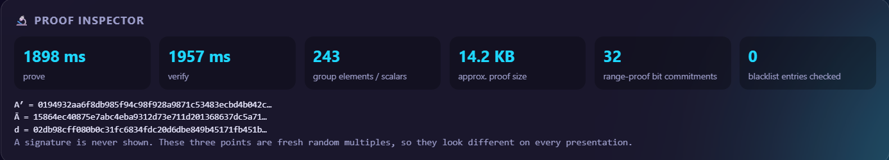

A signature is never shown. The three randomised points `A'`, `Ā` and `d` look different on every presentation.

### Revocation in action

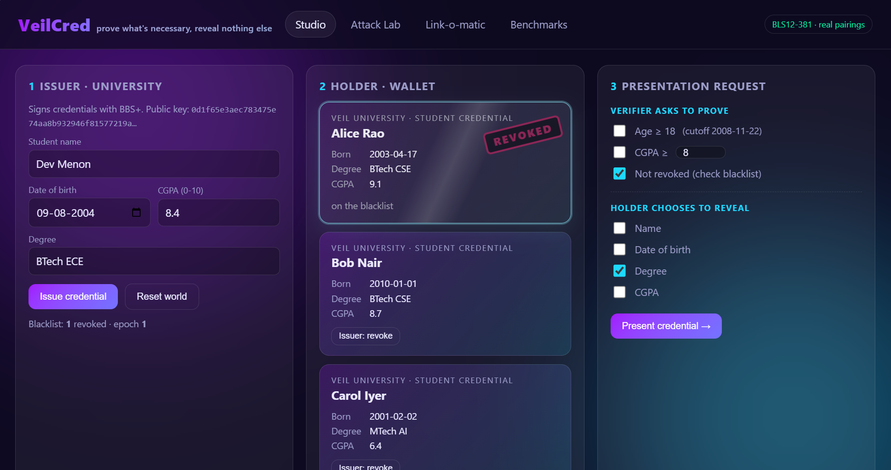

Once the issuer revokes a credential, the holder cannot even *build* a proof of non-revocation.

### Unlinkability: Link-o-matic

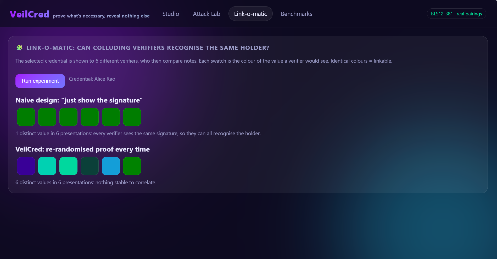

Six verifiers compare notes. With a naive "just show the signature" design they all see the same value.
With VeilCred, every presentation looks unrelated.

---

## 🔬 How it works

### The cast

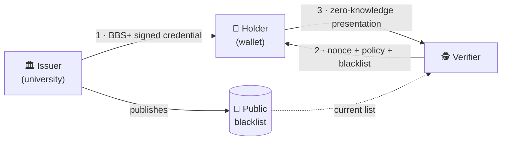

### One presentation, step by step

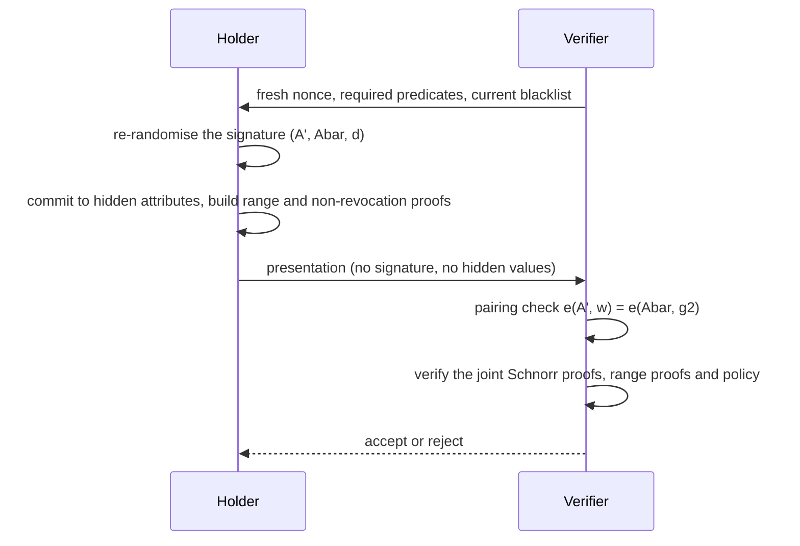

### The layers

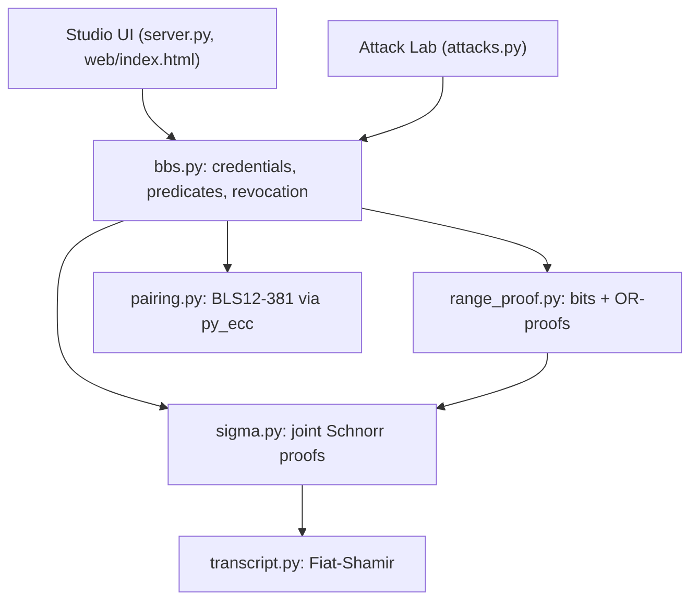

<details>
<summary><b>📐 The math, in five minutes</b> (click to expand)</summary>

<br>

**BBS+ signature.** The issuer has secret key `x` and public key `w = x·g2`. For attributes `m₁…m_L`:

```
B = P1 + s·h0 + Σ mᵢ·hᵢ          A = B / (x + e)          signature = (A, e, s)
verify:  e(A, w + e·g2) = e(B, g2)
```

**Presentation (re-randomised proof of knowledge).** The holder never shows `(A, e, s)`. Instead,
with fresh random `r1, r2`:

```
A' = r1·A        Abar = r1·B − e·A'   (= x·A')        d = r1·B − r2·h0
verifier checks   e(A', w) = e(Abar, g2)
and two Schnorr equations, proven jointly in zero knowledge:
   (1)  Abar − d                    = e·(−A') + r2·h0
   (2)  P1 + Σ_revealed mᵢ·hᵢ        = r3·d − s'·h0 − Σ_hidden mⱼ·hⱼ        (r3 = 1/r1, s' = s − r2·r3)
```

**Range predicates** (`attribute ≥ t` or `attribute ≤ t`):

1. Commit to the attribute, `C = m·Ga + ρ·Gb`, and prove (sharing the secret `m` with equation 2 above)
   that it is the same `m` the issuer signed.
2. Write the difference `m − t` in 32 bits and commit to every bit.
3. For every bit, prove `bit = 0 OR bit = 1` with a Cramer-Damgård-Schoenmakers OR-proof. The branch
   the prover doesn't know is *simulated*, so the verifier can't tell which was real.
4. The verifier checks that the weighted sum `Σ 2ⁱ·Cᵢ` equals the commitment to `m − t`.

**Private revocation.** Each credential has a random hidden *revocation handle* `m`. For every handle
`h` on the verifier's blacklist the holder proves knowledge of `y` with

```
y · (m − h) = 1          (an inverse exists only if m ≠ h)
```

For a revoked credential some `m − h` is zero, so no `y` exists and no proof can be built.

**Replay and context binding.** The verifier nonce, issuer key, disclosed values, claimed predicates
and a digest of the blacklist are all absorbed into the Fiat-Shamir challenge.

</details>

---

## 🚀 Quick start

**Requirements:** Python 3.10 or newer. No other tools are needed.

```bash
# 1 · clone and enter the project
git clone https://github.com/saivaishnav21/Veilcred.git
cd veilcred

# 2 · create a virtual environment
python -m venv .venv
.venv\Scripts\activate            # Windows (PowerShell)
# source .venv/bin/activate       # macOS / Linux

# 3 · install the dependencies
pip install -r requirements.txt
```

> **Windows tip:** if activation fails with *"running scripts is disabled"*, run
> `Set-ExecutionPolicy -Scope CurrentUser RemoteSigned` once and try again.

### Launch the Studio UI

```bash
python server.py
```

Your browser opens at <http://localhost:8000>. The UI is a plain Python server plus one HTML page,
with no extra packages. Pairings are pure Python, so a presentation takes a few seconds.

### Or run the command-line demos

```bash
python demo_phase1.py      # commitments + selective disclosure
python demo_phase2.py      # BBS+ credentials, unlinkability
python demo_phase3.py      # zero-knowledge predicates (age >= 18, CGPA >= 8)
python demo_phase4.py      # revocation, stale-list attack, cost vs blacklist size
python attack_lab.py       # run all 17 attacks, writes attack_report.md
python benchmark.py        # writes benchmark_results.md / .csv
python -m pytest -q        # full test suite
```

<details>
<summary><b>🧪 Developer note: the fast "toy" backend</b></summary>

<br>

`VEILCRED_BACKEND=toy` swaps the real pairing library for an **insecure** stand-in (group elements are
just scalars). It lets the protocol *algebra* be tested instantly, and proves nothing about security.

```powershell
$env:VEILCRED_BACKEND = "toy"      # PowerShell
python -m pytest -q
Remove-Item Env:VEILCRED_BACKEND   # back to the real backend
```

</details>

---

## 🎮 Try this in 3 minutes

Open the Studio and follow this script:

1. **Alice, tick "Age ≥ 18" and "Not revoked", reveal only *Degree*, then Present.**
   The verifier sees the degree and a blurred date of birth marked "✔ proven".
2. **Do the same for Bob** (born 2010). The holder cannot build a proof at all.
3. **Carol with "CGPA ≥ 8".** She has 6.4, so the proof can't exist.
4. **Click "Issuer: revoke" on Alice and present again.** She is blocked.
   Now untick "Not revoked" and present: she is accepted. This shows that revocation only works
   if the verifier actually checks the blacklist.
5. **Link-o-matic:** compare a naive design (identical values) with VeilCred (all different).
6. **Attack Lab → Run all attacks.**
7. **Benchmarks:** watch proof cost grow with blacklist size.

---

## ⚔️ Attack Lab

The lab runs real attacks against the real code, each in a fresh world with an honest verifier.
Alongside the 16 attacks there is a **control** (an honest user is accepted), so the lab can't "pass"
by rejecting everything.

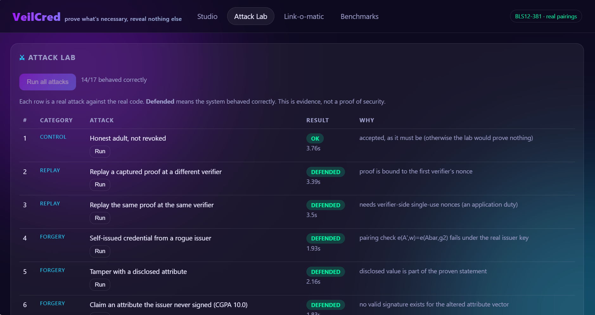

| Category | Attacks |
|---|---|
| **Replay** (2) | proof reused at another verifier · same proof resubmitted to the same verifier |
| **Forgery** (6) | rogue issuer · tampered disclosed attribute · lying about CGPA · splicing an adult's birth date into a minor's credential · degenerate (infinity) points · malleated proof |
| **Predicates** (4) | minor proves age honestly · wrap-around of a negative difference · commitment swap · weaker predicate than the verifier required |
| **Revocation** (3) | revoked holder presents · stale blacklist · own handle stripped from the list |
| **Privacy** (1) | colluding verifiers try to link presentations (naive baseline: 6/6 same-holder pairs link; VeilCred: 0) |

> This is evidence, not a proof of security. See [`docs/SECURITY.md`](docs/SECURITY.md) for the assumptions
> behind each guarantee, and the duties that fall on the verifier.

---

## 📈 Performance

Measured on the **real BLS12-381 backend** (pure Python, via `py_ecc`), median of 3 runs.
<br>🖥 *Machine: AMD Ryzen AI 7 445, 14 GB RAM · Python 3.15.2 · py_ecc 8.0.0*

### What a presentation costs

| Scenario | Prove | Verify | Proof size |
|---|---|---|---|
| Reveal one attribute (degree), nothing else | 0.10 s | 0.29 s | 0.5 KB |
| + one range predicate (*age ≥ 18*) | 0.81 s | 1.11 s | 9.1 KB |
| + two range predicates (*age ≥ 18*, *CGPA ≥ 8*) | 1.53 s | 1.94 s | 17.7 KB |
| *age ≥ 18* + non-revocation against **20** revoked credentials | 1.09 s | 1.69 s | 11.4 KB |

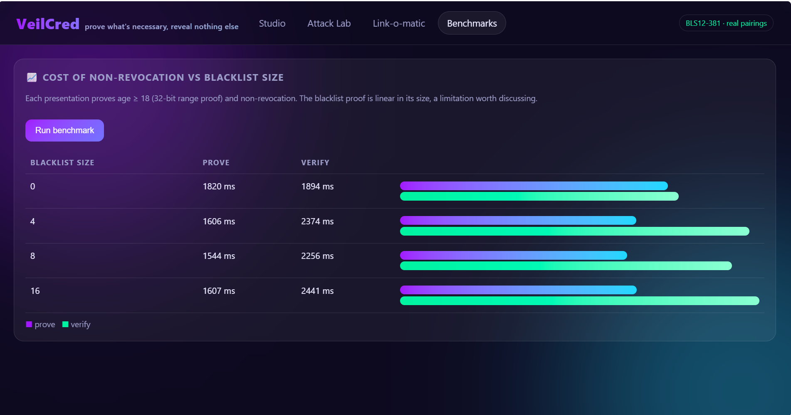

### Where the cost comes from

- **Pairings dominate a basic check.** Two pairings take ~144 ms, about half of the 0.29 s needed to verify a
  base presentation.
- **Range proofs dominate everything else.** Each 32-bit predicate adds about **0.72 s to prove, 0.84 s to
  verify and 8.6 KB**, because the proof is linear in the bit-length (32 bit commitments plus 32 OR-proofs).
- **Extra attributes are cheap.** Each additional attribute adds ~11 ms to prove, ~2.4 ms to verify and
  32 bytes (one scalar).
- **Revocation scales linearly.** Each blacklist entry adds ~14 ms to prove, ~29 ms to verify and ~112 bytes
  (one point and two scalars).

<details>
<summary><b>Building blocks</b></summary>

<br>

| Operation | Time |
|---|---|
| G1 scalar multiplication | 5.3 ms |
| Pairing check (2 pairings) | 143.6 ms |
| Hash to G1 | 6.3 ms |
| BBS+ sign (5 attributes) | 24.6 ms |
| BBS+ verify (5 attributes) | 223.2 ms |

</details>

Everything is pure Python, so a compiled pairing library would be much faster, and logarithmic-size range
proofs (Bulletproofs) would shrink the per-predicate cost. Both are on the [roadmap](#-roadmap).
Full tables: [`benchmark_results.md`](benchmark_results.md). Regenerate them with `python benchmark.py`.

## 🔐 Security model and limitations

The full write-up is in **[`docs/SECURITY.md`](docs/SECURITY.md)**: threat model, a property-by-property
argument, and an evidence map from each property to its tests and attacks.

**Guarantees (under the usual assumptions):** unforgeability · selective disclosure · zero knowledge ·
unlinkability of hidden material · replay resistance · predicate soundness · revocation soundness.

**Known limitations, stated openly:**

- 🧑‍🤝‍🧑 **No holder binding:** a credential can be lent to someone else.
- 👁 **The issuer sees all attributes** at issuance (no blind issuance yet).
- 📏 **Revocation cost is linear** in the blacklist size, and the blacklist is public.
- 📦 **Range proofs are linear in bit-length** (~9 KB per predicate).
- ✅ **Verifier duties:** fresh single-use nonces and the current blacklist.
- 🔗 **Identifying disclosed attributes** (like a unique ID number) can link presentations on their own.

> ⚠️ **Disclaimer.** This is an educational implementation: pure Python, not constant-time, not audited.
> It must not be used to protect real data.

---

## 🗂 Project structure

```
veilcred/
├── veilcred/                  the cryptography
│   ├── group.py                 secp256k1 arithmetic, from scratch
│   ├── transcript.py            Fiat-Shamir transcript
│   ├── sigma.py                 Schnorr proofs and joint proofs
│   ├── pedersen.py              Pedersen commitments, selective disclosure
│   ├── pairing.py               BLS12-381 backend (py_ecc) + insecure toy test backend
│   ├── bbs.py                   BBS+ credentials, presentations, predicates, revocation
│   ├── range_proof.py           bit-decomposition range proofs with OR-proofs
│   ├── revocation.py            revocation handles and the public blacklist
│   └── attacks.py               the attack lab scenarios
├── tests/                     test_phase1.py ... test_phase5.py
├── web/index.html             the Studio front end
├── docs/
│   ├── SECURITY.md              threat model and security analysis
│   └── images/                  screenshots used in this README
├── server.py                  Studio back end (standard library only)
├── attack_lab.py              run all attacks, writes attack_report.md
├── benchmark.py               writes benchmark_results.md / .csv
├── demo_phase1.py ... demo_phase4.py
├── smoke_real_backend.py      sanity-check of the pairing backend
├── requirements.txt
└── pytest.ini
```

---

## 🧱 Built in phases

| Phase | What it added |
|---|---|
| **1** | Elliptic-curve group, Pedersen commitments, Fiat-Shamir Schnorr proofs, selective disclosure |
| **2** | BLS12-381 pairings, BBS+ signatures, re-randomised presentations (unforgeability, unlinkability) |
| **3** | Zero-knowledge range proofs and predicates (*age ≥ 18*, *CGPA ≥ 8*) |
| **4** | Privacy-preserving revocation by blacklist non-membership |
| **5** | Attack Lab: 17 scenarios with a generated report |
| **6** | VeilCred Studio web UI |
| **7** | Benchmarks and the security analysis |

---

## 🗺 Roadmap

- [ ] Blind issuance plus a holder **link secret** (fixes the two biggest limitations above)
- [ ] Sub-linear revocation with accumulators or Merkle membership proofs
- [ ] Logarithmic-size range proofs (Bulletproofs)
- [ ] A compiled pairing library (e.g. `blst`) for speed
- [ ] Alignment with the IETF BBS signatures draft
- [ ] Device-bound credentials

---

## 📚 References

- D. Boneh, X. Boyen, H. Shacham. *Short Group Signatures.* CRYPTO 2004.
- M. H. Au, W. Susilo, Y. Mu. *Constant-Size Dynamic k-TAA.* SCN 2006. (BBS+)
- J. Camenisch, M. Drijvers, A. Lehmann. *Anonymous Attestation Using the Strong Diffie Hellman Assumption Revisited.* TRUST 2016.
- R. Cramer, I. Damgård, B. Schoenmakers. *Proofs of Partial Knowledge and Simplified Design of Witness Hiding Protocols.* CRYPTO 1994. (OR-proofs)
- T. P. Pedersen. *Non-Interactive and Information-Theoretic Secure Verifiable Secret Sharing.* CRYPTO 1991. (commitments)
- A. Fiat, A. Shamir. *How to Prove Yourself: Practical Solutions to Identification and Signature Problems.* CRYPTO 1986.
- IETF CFRG draft, *The BBS Signature Scheme.*
- [`py_ecc`](https://github.com/ethereum/py_ecc): BLS12-381 pairing arithmetic.

---

<div align="center">

Built by P Sai Vaishnav Reddy · Applied Cryptography · 7th semester<br>
<sub>Educational project. Not for protecting real data.</sub>

</div>